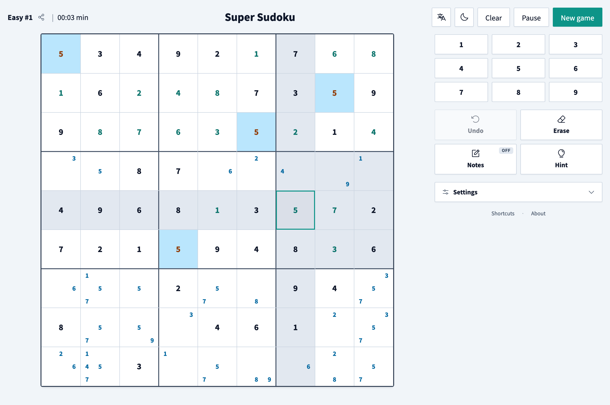
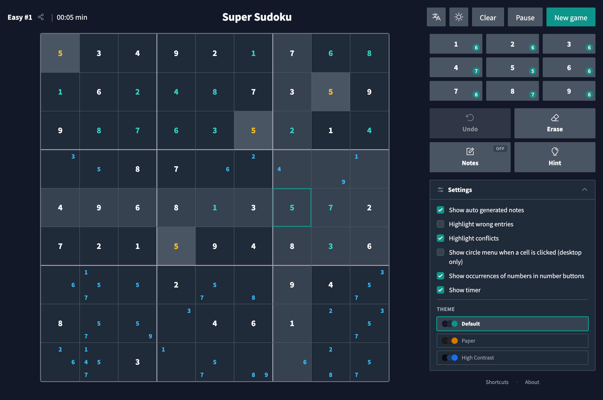
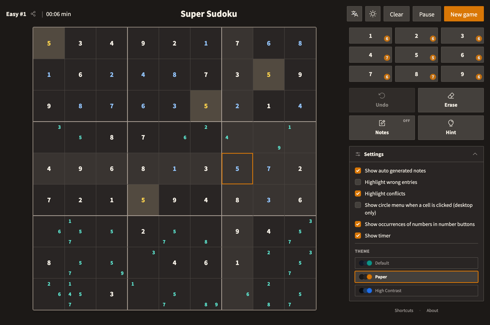
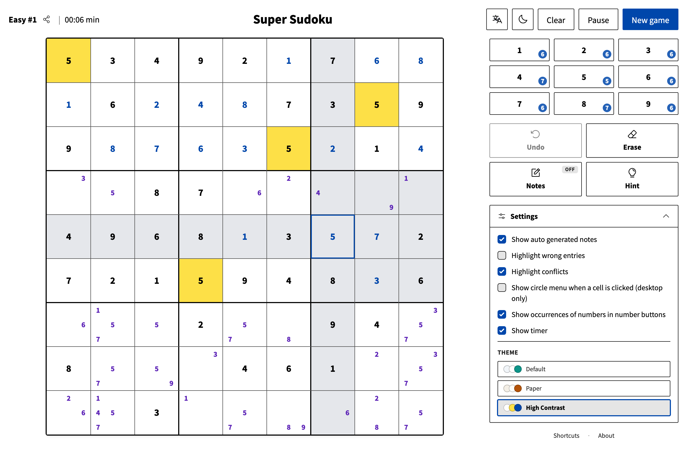
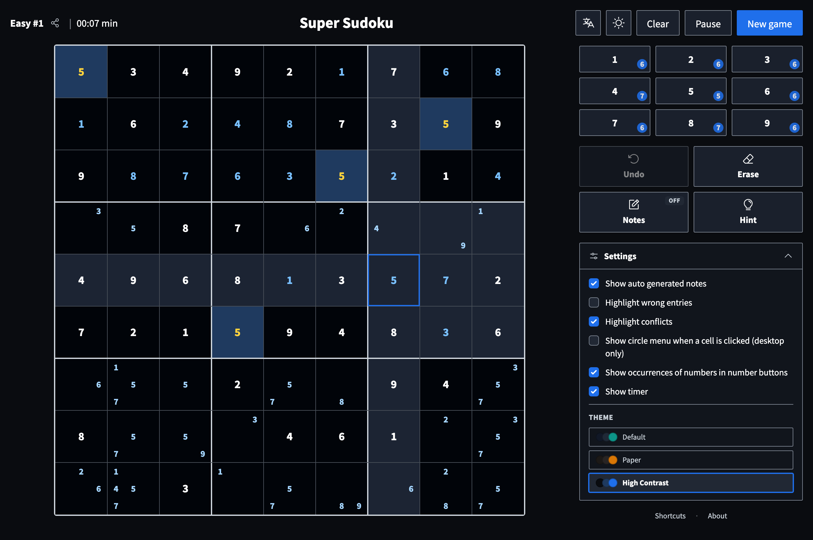
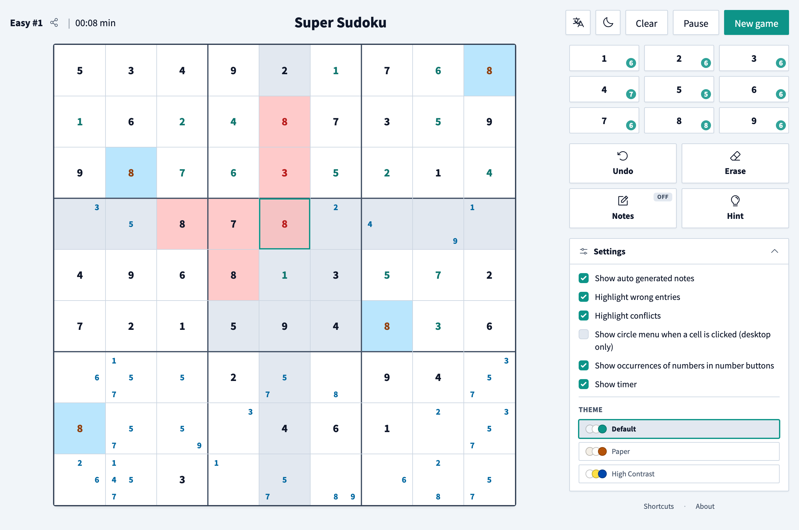
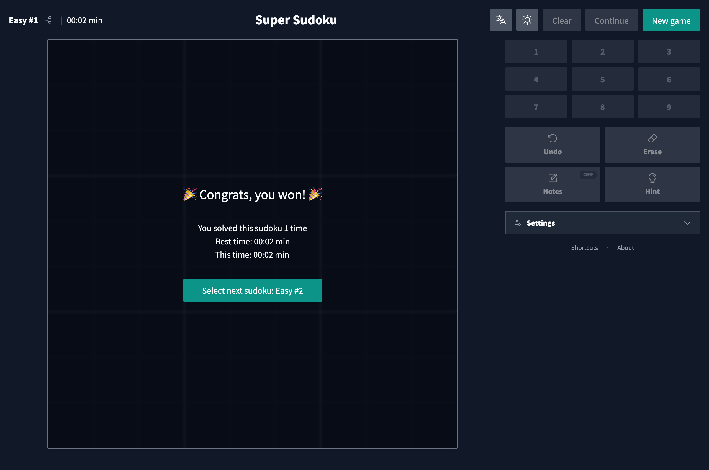
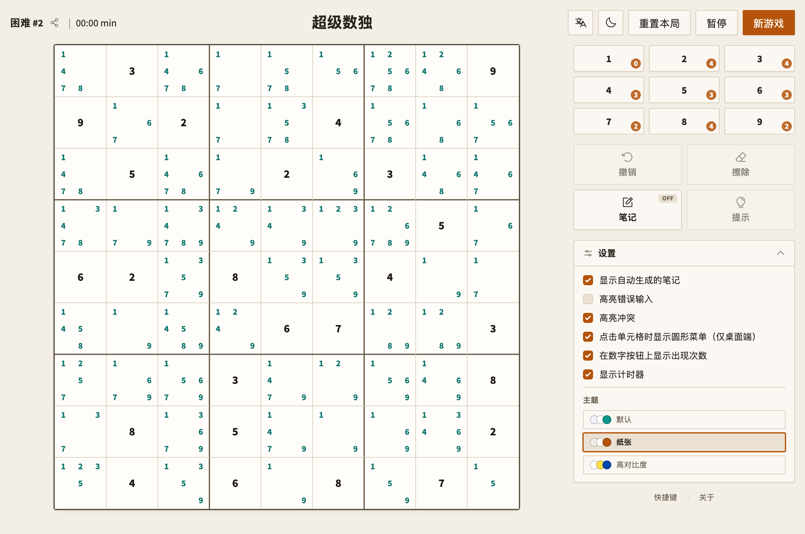

# Super Sudoku 🧩

[](https://sudoku.tn1ck.com)
[](LICENSE)
[](https://nodejs.org/)
[](https://sudoku.tn1ck.com)
[](#-languages)

**A free, open-source online Sudoku game built to match or exceed commercial Sudoku apps — with no ads, no tracking, no paywalls, and full offline play.**

🌐 **Play free in your browser:** [https://sudoku.tn1ck.com](https://sudoku.tn1ck.com)



## ✨ Why Super Sudoku?

Born from a simple request — my Grandma wanted to play Sudoku, and I wasn't happy with the ad-heavy, paywalled apps out there. Super Sudoku is an open-source Sudoku web app (PWA) designed to match or exceed commercial Sudoku apps like Sudoku.com while staying completely free, ad-free, account-free, and tracking-free.

- **30,000+ verified puzzles** across 5 difficulty levels (Easy, Medium, Hard, Expert, Evil) — generated with a constraint-satisfaction solver so every puzzle has a unique solution
- **Zero ads, zero tracking, no account required** — all progress and stats stay locally in your browser
- **Play anywhere, even offline** — installable Progressive Web App (PWA) for desktop and mobile, or self-host your own instance with Docker
- **Built for readability and speed** — 3 themes (**Default**, **Paper**, **High Contrast**) in both Light and Dark mode, desktop radial circle menu, smart auto-notes, keyboard shortcuts, and 7 languages

---

## 🎨 Themes & Light/Dark Mode

Pick between **3 built-in themes** (**Default**, **Paper**, and **High Contrast**) and switch between **Light** and **Dark** mode independently for any of them (following your system preference by default).

<table>
  <thead>
    <tr>
      <th width="50%">Default — Light</th>
      <th width="50%">Default — Dark (Expanded Settings)</th>
    </tr>
  </thead>
  <tbody>
    <tr>
      <td></td>
      <td></td>
    </tr>
  </tbody>
</table>

<table>
  <thead>
    <tr>
      <th width="50%">Paper — Light</th>
      <th width="50%">Paper — Dark</th>
    </tr>
  </thead>
  <tbody>
    <tr>
      <td></td>
      <td></td>
    </tr>
  </tbody>
</table>

<table>
  <thead>
    <tr>
      <th width="50%">High Contrast — Light</th>
      <th width="50%">High Contrast — Dark</th>
    </tr>
  </thead>
  <tbody>
    <tr>
      <td></td>
      <td></td>
    </tr>
  </tbody>
</table>

---

## 📸 Screenshots

### Gameplay & Helpers

<table>
  <thead>
    <tr>
      <th width="50%">Radial Circle Menu</th>
      <th width="50%">Conflict Detection &amp; Number Counts</th>
    </tr>
  </thead>
  <tbody>
    <tr>
      <td>
        
        <br /><sub>Click any cell to pick a number quickly, or right-click to toggle pencil notes without switching modes.</sub>
      </td>
      <td>
        
        <br /><sub>Optional conflict highlighting, wrong-entry alerts, auto-generated notes, and number counts on the keypad.</sub>
      </td>
    </tr>
    <tr>
      <th width="50%">Keyboard Shortcuts</th>
      <th width="50%">Win Screen &amp; Stats</th>
    </tr>
    <tr>
      <td>
        
        <br /><sub>Quick-reference shortcuts modal — press <code>Escape</code> to close it without pausing your game.</sub>
      </td>
      <td>
        
        <br /><sub>Shows how many times you've solved a puzzle, your best time, and lets you jump straight into the next one.</sub>
      </td>
    </tr>
  </tbody>
</table>

### Puzzle Library, Custom Puzzles & Languages

<table>
  <thead>
    <tr>
      <th width="50%">30,000+ Puzzles &amp; Saved Progress</th>
      <th width="50%">Custom Sudoku Creator</th>
    </tr>
  </thead>
  <tbody>
    <tr>
      <td>
        
        <br /><sub>Browse 5 difficulty levels (Easy to Evil) plus your own collections, with play times and solve history.</sub>
      </td>
      <td>
        
        <br /><sub>Add your own puzzles with automatic solvability and unique-solution checking in the background.</sub>
      </td>
    </tr>
  </tbody>
</table>

<p align="center">
  
  <br />
  <sub>🌍 Available in <strong>7 languages</strong>: English, Français, Español, Deutsch, Italiano, Português, and 中文.</sub>
</p>

### Mobile & Offline Play

<table>
  <thead>
    <tr>
      <th width="33%">Mobile — Default Light</th>
      <th width="33%">Mobile — Default Dark</th>
      <th width="33%">Mobile — Paper</th>
    </tr>
  </thead>
  <tbody>
    <tr>
      <td></td>
      <td></td>
      <td></td>
    </tr>
  </tbody>
</table>

---

## 🚀 Features

### 🎮 Gameplay
- **30,000+ Puzzles**: 6,000+ puzzles per level across **5 difficulties** (*Easy, Medium, Hard, Expert, Evil*).
- **Hints**: Reveal a single cell when you're stuck, automatically clearing conflicting notes.
- **Undo & Redo**: Full move history with `Ctrl/Cmd + Z` and `Ctrl/Cmd + Y`.
- **Automatic Saving**: Your board, notes, timer, solve counts, and best times are saved locally in your browser.
- **Hide Timer Option**: Hide the timer from the header in Settings if you'd rather play without watching the clock — your elapsed time is still tracked in the background for your solve stats.
- **Shareable Links**: Copy a link to send the exact same puzzle to a friend.
- **Print-Friendly Sheets**: Print the current puzzle cleanly on paper (in crisp black-and-white regardless of theme or dark mode), or print a 6-per-page sheet straight from the puzzle picker.

### 📝 Notes & Helpers
- **Desktop Circle Menu**: Click any cell to pick a number right at your cursor, or right-click to add/remove notes without leaving number mode.
- **Auto & Manual Notes**: Turn on auto-generated candidates that update as you solve, or write your own pencil marks (with copy/paste support).
- **Conflict & Mistake Highlighting**: Highlight duplicate numbers in real time, with an optional toggle to flag wrong entries.
- **Number Counts**: Show how many times each digit `1–9` is placed on the board.

### 🎨 Look & Feel
- **3 Themes × Light & Dark Modes**: Choose **Default**, warm **Paper**, or **High Contrast**, each with its own Light and Dark palette.
- **Clean Layout**: Collapsible settings panel, simple Phosphor icons, and a decluttered mobile header.
- **Works Offline (PWA)**: Install it to your phone or desktop and play without an internet connection.

### 🌍 Languages
Translated into **7 languages** with automatic browser language detection:
**English** · **Français** · **Español** · **Deutsch** · **Italiano** · **Português** · **中文**

---

## ⌨️ Keyboard Shortcuts

| Action | Shortcut |
| :--- | :--- |
| **Move around the board** | `Arrow Keys` |
| **Set number / toggle note** | `1` – `9` |
| **Delete number** | `Backspace` |
| **Pause / resume game** | `Escape` |
| **Get a hint** | `H` |
| **Toggle notes mode** | `N` |
| **Undo / Redo** | `Ctrl / Cmd` + `Z` / `Y` |
| **Copy / Paste notes** | `Ctrl / Cmd` + `C` / `V` |

---

## 🛠️ Development Setup

[](https://picorunner.com/launch/?repository=https%3A%2F%2Fgithub.com%2FTN1ck%2Fsuper-sudoku)

### Prerequisites
- **Node.js** `>= 22.18` — [Download here](https://nodejs.org/en/download/package-manager/)
- **Vite+ (`vp`)** — unified toolchain for dev, build, lint, formatting, type-checking, unit tests, and TypeScript scripts ([viteplus.dev](https://viteplus.dev/))

### Quick Start

```bash
# Clone the repository
git clone https://github.com/tn1ck/super-sudoku.git
cd super-sudoku

# Install dependencies
vp install

# Start the development server
vp dev
```

The app will be available at [http://127.0.0.1:3000](http://127.0.0.1:3000).

### Common Commands

```bash
# Build for production (output in dist/)
vp build

# Format, lint, and typecheck
vp check

# Run unit tests
vp test run

# Run Flashwright end-to-end tests
vp run test:e2e
```

---

## 🐳 Docker Deployment

### Build & Run Locally

```bash
# Build the image
docker build -t super-sudoku:latest .

# Run the container (map to your preferred port)
docker run -p 8081:80 super-sudoku:latest
```

### Pre-built Images

Pre-built images are available on [GitHub Container Registry](https://github.com/tn1ck/super-sudoku/pkgs/container/super-sudoku).

---

## 🧩 Puzzle Generation

Super Sudoku includes a constraint-satisfaction puzzle generator and solver (AC-3 + backtracking) based on the paper *"Rating and Generating Sudoku Puzzles Based On Constraint Satisfaction Problems."*

📖 Read the full write-up on how the generator and difficulty rating work: [How to Generate Sudokus](https://tn1ck.com/blog/how-to-generate-sudokus).

You can generate new puzzles by difficulty using [`scripts/generate_sudokus.ts`](./scripts/generate_sudokus.ts):

```bash
npm run generate-easy-sudokus
npm run generate-medium-sudokus
npm run generate-hard-sudokus
npm run generate-expert-sudokus
npm run generate-evil-sudokus
```

---

## ❓ Frequently Asked Questions

**Is Super Sudoku really free, with no ads or tracking?**
Yes. Super Sudoku is MIT-licensed open-source software with zero ads, zero analytics/tracking, and no login or paywalls. Your games, notes, and best times are saved locally in your browser.

**Does Super Sudoku work offline?**
Yes. Super Sudoku is an installable Progressive Web App (PWA). Once loaded at [sudoku.tn1ck.com](https://sudoku.tn1ck.com), you can add it to your phone's home screen or desktop and play all 30,000+ puzzles offline.

**How are puzzles generated and difficulty-rated?**
Puzzles are generated and rated using an AC-3 constraint-satisfaction and backtracking solver inspired by *"Rating and Generating Sudoku Puzzles Based On Constraint Satisfaction Problems,"* guaranteeing every puzzle has a single unique solution. See the full breakdown in [How to Generate Sudokus](https://tn1ck.com/blog/how-to-generate-sudokus).

**Can I create, import, or share my own Sudoku puzzles?**
Yes. You can create custom collections and add your own puzzles in the built-in Sudoku creator, which verifies solvability and uniqueness in the background. Any puzzle can also be shared via a direct URL using the Share button.

**Can I self-host Super Sudoku?**
Yes. Pre-built Docker images are published on [GitHub Container Registry](https://github.com/tn1ck/super-sudoku/pkgs/container/super-sudoku), or you can build the static site yourself with `vp build`.

---

## 🤝 Contributing

Contributions are always welcome!

1. **Fork** the repository
2. **Create** a feature branch (`git checkout -b feature/amazing-feature`)
3. **Commit** your changes (`git commit -m 'Add amazing feature'`)
4. **Push** to the branch (`git push origin feature/amazing-feature`)
5. **Open** a Pull Request

### Areas for Contribution
- 🎨 New themes & UI improvements
- 🧩 Puzzle generation & difficulty rating
- 🌍 New translations
- 📱 Mobile improvements
- 🐛 Bug fixes & tests

---

## 📄 License

This project is licensed under the MIT License — see the [LICENSE](LICENSE) file for details.

## 🙏 Acknowledgments

- Research paper: *"Rating and Generating Sudoku Puzzles Based On Constraint Satisfaction Problems"*
- [Phosphor Icons](https://phosphoricons.com/)
- The open-source community for inspiration and tools
- My Grandma for the original motivation! ❤️

---

**Missing a feature or spotted a bug?** [Open an issue](https://github.com/tn1ck/super-sudoku/issues) and let us know!
