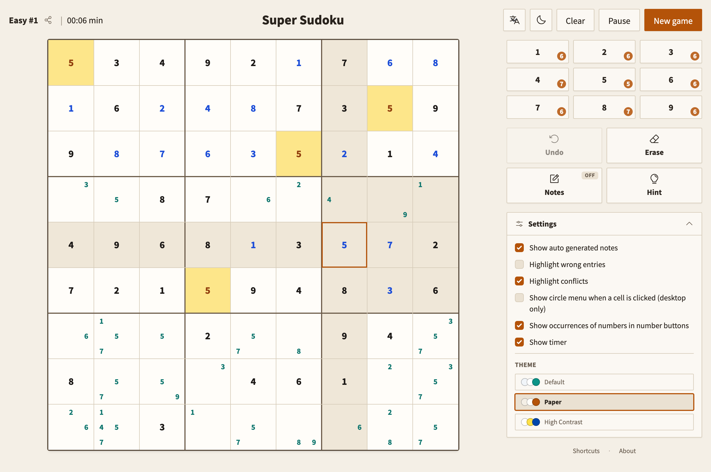
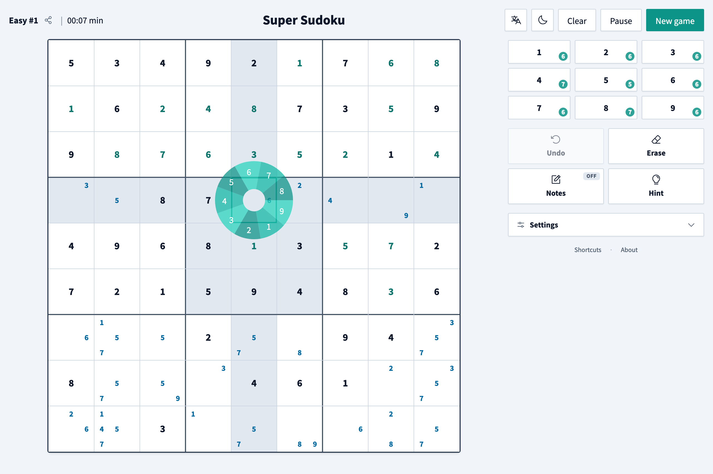
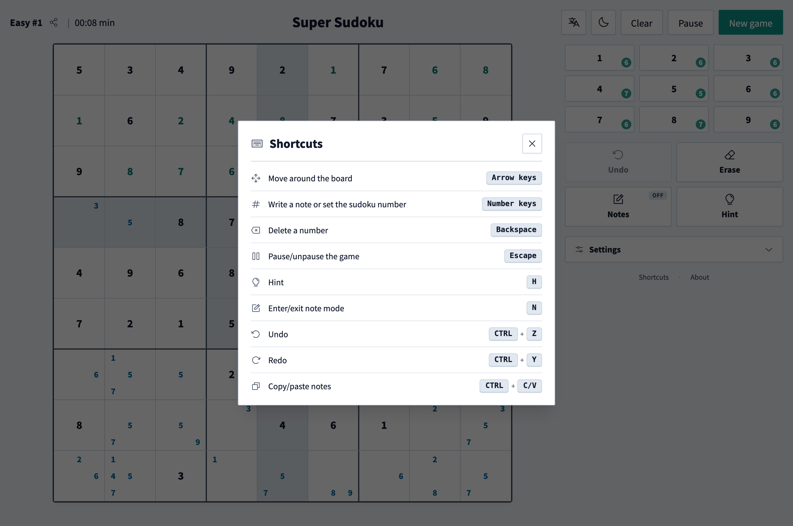
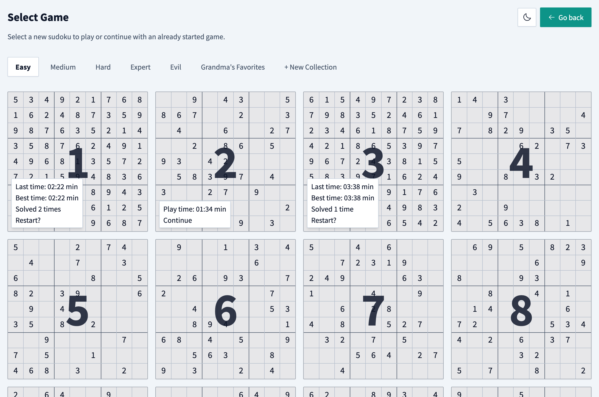
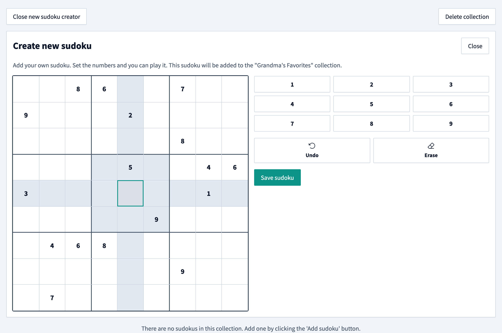
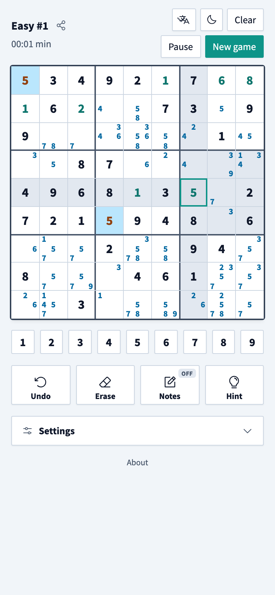
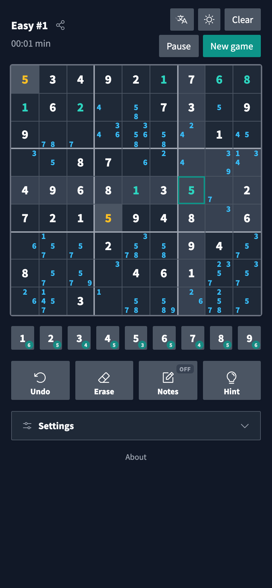
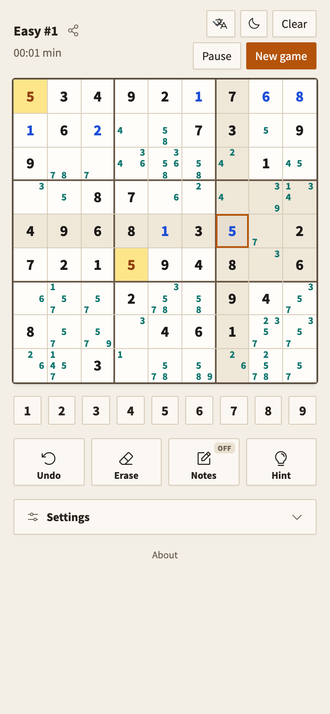

# Super Sudoku 🧩

[](https://sudoku.tn1ck.com)
[](LICENSE)
[](https://nodejs.org/)
[](https://sudoku.tn1ck.com)
[](#-internationalization)

**A crisp, open-source Sudoku web app crafted for focus — free, ad-free, tracking-free, and offline-ready.**

🌐 **Play Now:** [https://sudoku.tn1ck.com](https://sudoku.tn1ck.com)

<p align="center">
  
  <br />
  <sub>
    🎬 <a href="./docs/showcase.mp4"><strong>Watch / Download Full HD Video Showcase (1280×720 · 30fps MP4)</strong></a>
  </sub>
</p>

## ✨ Why Super Sudoku?

Born from a simple request — my Grandma wanted to play Sudoku, but I wasn't satisfied with the ad-heavy, cluttered apps out there. Super Sudoku delivers a calm, thoughtful puzzle experience that rivals or exceeds commercial apps while staying 100% open source, free of charge, free of ads, and free of tracking.

---

## 🎨 Themes & Visual Styles

Super Sudoku features a CSS-variable theming system with **3 curated themes** — each supporting both **Light** and **Dark** modes (with automatic system preference detection) and unified **Phosphor** iconography.

<table>
  <thead>
    <tr>
      <th width="50%">Default — Light</th>
      <th width="50%">Default — Dark (Expanded Settings)</th>
    </tr>
  </thead>
  <tbody>
    <tr>
      <td></td>
      <td></td>
    </tr>
  </tbody>
</table>

<table>
  <thead>
    <tr>
      <th width="50%">Paper — Light</th>
      <th width="50%">Paper — Dark</th>
    </tr>
  </thead>
  <tbody>
    <tr>
      <td></td>
      <td></td>
    </tr>
  </tbody>
</table>

<table>
  <thead>
    <tr>
      <th width="50%">High Contrast — Light</th>
      <th width="50%">High Contrast — Dark</th>
    </tr>
  </thead>
  <tbody>
    <tr>
      <td></td>
      <td></td>
    </tr>
  </tbody>
</table>

---

## 📸 Feature Gallery

### Gameplay, Radial Circle Menu & Smart Assistance

<table>
  <thead>
    <tr>
      <th width="50%">Interactive Radial Circle Menu</th>
      <th width="50%">Conflict Detection &amp; Occurrence Counters</th>
    </tr>
  </thead>
  <tbody>
    <tr>
      <td>
        
        <br /><sub>Left-click any cell for quick number entry, or right-click to toggle pencil notes without leaving number mode.</sub>
      </td>
      <td>
        
        <br /><sub>Optional real-time conflict highlighting, wrong-entry alerts, auto-generated notes, and keypad occurrence badges.</sub>
      </td>
    </tr>
    <tr>
      <th width="50%">Keyboard Shortcuts Modal</th>
      <th width="50%">Victory &amp; Solve Statistics Overlay</th>
    </tr>
    <tr>
      <td>
        
        <br /><sub>Clean, accessible modal with keycap hints — press <code>Escape</code> to close without pausing your game.</sub>
      </td>
      <td>
        
        <br /><sub>Tracks solve counts, personal best times, and lets you jump straight into the next puzzle.</sub>
      </td>
    </tr>
  </tbody>
</table>

### Puzzle Library, Custom Creator & Internationalization

<table>
  <thead>
    <tr>
      <th width="50%">3,000+ Puzzles &amp; Progress Tracking</th>
      <th width="50%">Custom Sudoku Creator</th>
    </tr>
  </thead>
  <tbody>
    <tr>
      <td>
        
        <br /><sub>Browse 5 difficulty levels (Easy to Evil) plus your own custom collections, with play times and solve history.</sub>
      </td>
      <td>
        
        <br /><sub>Build your own puzzles with live solvability and unique-solution verification running in a background Web Worker.</sub>
      </td>
    </tr>
  </tbody>
</table>

<p align="center">
  
  <br />
  <sub>🌍 Localized in <strong>7 languages</strong>: English, Français, Español, Deutsch, Italiano, Português, and 中文.</sub>
</p>

### Mobile & Responsive PWA

<table>
  <thead>
    <tr>
      <th width="33%">Mobile — Default Light</th>
      <th width="33%">Mobile — Default Dark</th>
      <th width="33%">Mobile — Paper</th>
    </tr>
  </thead>
  <tbody>
    <tr>
      <td></td>
      <td></td>
      <td></td>
    </tr>
  </tbody>
</table>

---

## 🚀 Key Features

### 🎮 Core Gameplay
- **3,000+ Curated Puzzles**: ~600 puzzles per tier across **5 difficulty levels** (*Easy, Medium, Hard, Expert, Evil*).
- **Smart Hints**: Reveal a single cell when you're stuck while automatically clearing conflicting notes.
- **Full Undo / Redo History**: Step backward and forward seamlessly (`Ctrl/Cmd + Z` & `Ctrl/Cmd + Y`).
- **Auto-Save & Solve Statistics**: Your board, notes, timer, solve counts, and best times persist locally in your browser.
- **Optional Hide Timer**: Toggle the timer off in Settings for relaxed, pressure-free solving.
- **Shareable Puzzle Links**: Copy a direct URL to share the exact puzzle with friends.

### 📝 Precision Input & Smart Notes
- **Desktop Radial Circle Menu**: Click any cell to pick a number in one fluid motion — or right-click for instant note toggling.
- **Auto-Generated & Manual Notes**: Automatically maintain valid candidates as you play, or manage custom pencil marks with copy/paste support.
- **Conflict & Error Highlighting**: Real-time visual feedback for duplicate digits and optional wrong-entry indicators.
- **Number Occurrence Tracking**: See at a glance how many times each digit `1–9` appears on the board.

### 🎨 Modern Design & Accessibility
- **3 Themes × Light & Dark Modes**: Switch effortlessly between **Default**, warm **Paper**, and accessible **High Contrast**.
- **Clean, Collapsible Workspace**: Settings tuck away neatly by default; Shortcuts and About open in distraction-free modals.
- **Responsive & Offline-Ready PWA**: Install directly to your home screen or desktop and play completely offline.

### 🌍 Internationalization
Available in **7 languages** with automatic browser language detection:
**English** · **Français** · **Español** · **Deutsch** · **Italiano** · **Português** · **中文**

---

## ⌨️ Keyboard Shortcuts

| Action | Shortcut |
| :--- | :--- |
| **Move around the board** | `Arrow Keys` |
| **Set number / toggle note** | `1` – `9` |
| **Delete number** | `Backspace` |
| **Pause / resume game** | `Escape` |
| **Get a hint** | `H` |
| **Toggle notes mode** | `N` |
| **Undo / Redo** | `Ctrl / Cmd` + `Z` / `Y` |
| **Copy / Paste notes** | `Ctrl / Cmd` + `C` / `V` |

---

## 🛠️ Development Setup

### Prerequisites
- **Node.js** `>= 22.18` — [Download here](https://nodejs.org/en/download/package-manager/)
- **Vite+ (`vp`)** — unified toolchain for dev, build, lint, formatting, type-checking, unit testing, and TypeScript scripts ([viteplus.dev](https://viteplus.dev/))

### Quick Start

```bash
# Clone the repository
git clone https://github.com/tn1ck/super-sudoku.git
cd super-sudoku

# Install dependencies
vp install

# Start the development server
vp dev
```

The app will be available at [http://127.0.0.1:3000](http://127.0.0.1:3000).

### Common Commands

```bash
# Build for production (output in dist/)
vp build

# Format, lint, and typecheck
vp check

# Run unit tests
vp test run

# Run Flashwright end-to-end tests
vp run test:e2e
```

---

## 🐳 Docker Deployment

### Build & Run Locally

```bash
# Build the image
docker build -t super-sudoku:latest .

# Run the container (map to your preferred port)
docker run -p 8081:80 super-sudoku:latest
```

### Pre-built Images

Ready-to-use images are published on [GitHub Container Registry](https://github.com/tn1ck/super-sudoku/pkgs/container/super-sudoku).

---

## 🧩 Puzzle Generation

Super Sudoku includes a constraint-satisfaction puzzle generator and solver (AC-3 + backtracking) inspired by the paper *"Rating and Generating Sudoku Puzzles Based On Constraint Satisfaction Problems."*

📖 **Deep Dive:** Read the full write-up on how the generator and difficulty rating work at [How to Generate Sudokus](https://tn1ck.com/blog/how-to-generate-sudokus).

Generate puzzles by difficulty with [`scripts/generate_sudokus.ts`](./scripts/generate_sudokus.ts):

```bash
npm run generate-easy-sudokus
npm run generate-medium-sudokus
npm run generate-hard-sudokus
npm run generate-expert-sudokus
npm run generate-evil-sudokus
```

---

## 🤝 Contributing

Contributions are warmly welcomed!

1. **Fork** the repository
2. **Create** a feature branch (`git checkout -b feature/amazing-feature`)
3. **Commit** your changes (`git commit -m 'Add amazing feature'`)
4. **Push** to the branch (`git push origin feature/amazing-feature`)
5. **Open** a Pull Request

### Ideas for Contribution
- 🎨 Additional color themes & visual polish
- 🧩 New puzzle generation or difficulty-rating algorithms
- 🌍 Additional language translations
- 📱 Mobile ergonomics & touch enhancements
- 🐛 Bug fixes & test coverage

---

## 📄 License

This project is licensed under the MIT License — see the [LICENSE](LICENSE) file for details.

## 🙏 Acknowledgments

- Research paper: *"Rating and Generating Sudoku Puzzles Based On Constraint Satisfaction Problems"*
- [Phosphor Icons](https://phosphoricons.com/) for the crisp icon system
- The open-source community for inspiration and tools
- My Grandma for the original motivation! ❤️

---

**Missing a feature or spotted a bug?** [Open an issue](https://github.com/tn1ck/super-sudoku/issues) and let us know!
